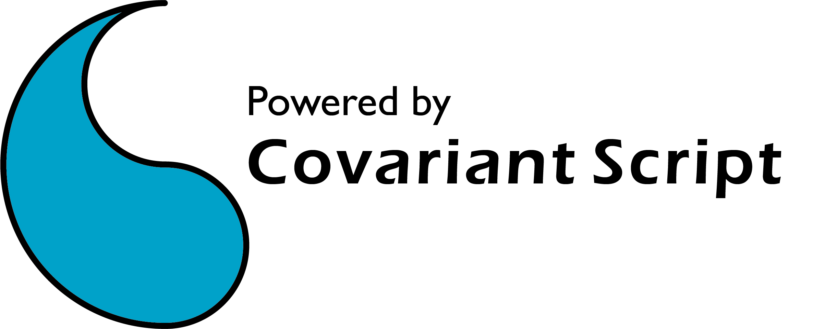

# Covariant Script Package Manager



Covariant Script Package Manager is an online package manager written in Covariant Script itself.

## Dependency
+ [Covariant Script Interpreter](https://github.com/covscript/covscript): STD210505 or newer version
+ [CovScript Process](https://github.com/covscript/covscript-process)
+ [CovScript Regex](https://github.com/covscript/covscript-regex)
+ [CovScript Codec](https://github.com/covscript/covscript-codec)
+ [CovScript cURL](https://github.com/covscript/covscript-curl)

## Usage
```
Usage: cspkg <commands> ... [options] ...

Commands:
    init                          Initialize cspkg environment and configuration
    install   | -i  <Package>...  Install packages from remote source
    remove    | -r  <Package>...  Remove packages
    config    | -c  <Key>         Manage local configuration
    upgrade   | -u                Upgrade local packages
    build     | -b  [Path]        Build & test local packages
    list      | -l                List current packages
    doctor                        Diagnose and optionally fix common problems
    help      | -h                Show help information
    version   | -v                Show version information

Options:
  General
    --yes                         Assume yes; skip confirmation prompts

  cspkg install
    --fix                         Fix broken dependencies
    --import                      Scanning local CovScript packages
    --show-avail                  Show available CovScript packages in remote source

  cspkg upgrade
    --retread                     Retread all local packages and their dependencies

  cspkg config
    --set         <Value>         Set a configuration key
    --app         <Value>         Append to a configuration key
    --unset                       Restore a configuration key to default

  cspkg build
    --install     [Package]...    Install a local package
    --compile     [Argument]...   Compile a CXX extension or ECS source
    --release     <Source URL>    Generate package index files for release
    --flat                        Don't create cspkg-repo directory structure

```

## Configure CSPKG

Local path: `~/.cspkg/config.json`

```json
{
	"arch": "x86_64",
	"home": "PATH-TO-COVSCRIPT-HOME",
	"source": "URL-OF-REPO;URL-OF-REPO",
	"proxy": "URL-OF-HTTP-PROXY",
	"timeout_ms": "3000"
}
```

For fresh installment, you can run `cspkg init` to generate config file manually.

## Diagnostics

Run `cspkg doctor` for a health check of your cspkg setup. It reports one
`[OK] / [WARN] / [FAIL] / [INFO]` line per check across:

+ **Environment** — CovScript STD/platform/arch, `USER_HOME`, `COVSCRIPT_HOME`, and the `imports/` directory (existence and writability).
+ **Configuration** — `~/.cspkg`, `config.json` validity, required keys, and source/proxy URLs.
+ **cspkg installation** — the `imports/cspkg.csp` file and its `packages.json` record are consistent.
+ **Remote sources** — each configured source is reachable, a valid repository, and offers `cspkg`.
+ **Local packages** — `imports/` matches `packages.json` (orphaned records, unmanaged files, broken dependencies).
+ **Build tools** — whether `ecs` (for `.ecs` packages) and `g++` + `CS_DEV_PATH` (for extensions) are available.

After the summary, doctor offers to repair auto-fixable problems (recreate a
missing/corrupt config, create missing directories, reinstall a broken cspkg, or
run `install --fix` for dependency issues). Pass `--yes` to apply fixes without
prompting. It exits non-zero when unresolved errors remain, so it is safe to use
in scripts.

## Architecture of a typical CSPKG repository

### File Storage

Typically a CSPKG repository is a HTTP(s) site in following structure:

- http://mirrors.covariant.cn/cspkg_v2/
  - index.json
  - index
    - universal
      - index.json
      - xxx.json
    - winucrt
      - universal
        - index.json
        - xxx.json
      - x86_64
        - index.json
        - xxx.json
    - linux
      - x86_64
        - index.json
        - xxx.json
    - macos
      - arm64
        - index.json
        - xxx.json
  - universal
    - xxx.csp
  - winucrt/universal
    - xxx.csp
  - winucrt/x86_64
    - xxx.cse
  - linux/x86_64
    - xxx.cse
  - macos/arm64
    - xxx.cse

The root `index.json` is an array listing the tiers this repository provides, e.g.
`["universal", "winucrt/universal", "winucrt/x86_64"]`. cspkg fetches, per source,
whichever of these three tiers exist and apply to the current platform/arch:

- `universal` — platform- and arch-independent packages (`index/universal/`).
- `<platform>/universal` — platform-specific but arch-independent packages
  (`index/<platform>/universal/`).
- `<platform>/<arch>` — platform- and arch-specific packages, e.g. compiled
  extensions (`index/<platform>/<arch>/`).

Each tier directory holds an `index.json` (array of package names) plus one
`<name>.json` package description per package.

You can also use local storage by setting source to URL like `file:///path-to-your-local-repo/`.

> **Note on platform directory names:** The platform segment (`winucrt`, `linux`, `macos`, ...)
> matches what cspkg reports for your CovScript build. Since CovScript STD `250901`, the name comes
> directly from `system.os_name` / `system.arch_name`; older interpreters fall back to the legacy
> mapping (`winucrt` / `linux` / `macos`). Run `cspkg version` to see the exact `OS` and `ARCH`
> values used to locate packages.


## Build your package

### Step 1: Write your Package Description File
#### Package Description File Template:
```json
{
    "Name": "test",
    "Info": "Test Package",
    "Author": "Anonymous",
    "Version": "1.0.0",
    "Target": "URL to your package",
    "Dependencies": []
}

```
+ `Name` is the unique identifier of the package and cannot be repeated.
+ `Info` is the description of your package, should be short in one sentence.
+ `Author` is the name of the package author.
+ `Version` is the version of your package, which will be sorted in lexicographical order.
+ `Target` is the URL of your file (`.csp`, `.cse`, `.csym` or `.ecsx`), you can use GitHub as your server.
+ `Dependencies` is an array of package names you depend on.

#### Example:
```json
{
    "Name": "csdbc_mysql",
    "Info": "CSDBC MySQL Driver",
    "Author": "CovScript Organization",
    "Version": "1.0.0",
    "Target": "http://mirrors.covariant.cn/cspkg_v2/universal/csdbc_mysql.csp",
    "Dependencies": [
        "database",
        "codec",
        "csdbc",
        "regex"
    ]
}
```
### Step 2: Upload your Package Description File
You can:
+ Upload with your project file to GitHub or other VCS (Recommended!!!)
+ Upload to dedicated server(mostly for releasing purpose)

### Step 3: Building your package
If your package is written in Covariant Script, there's no need for extra building. But if you are writting an Covariant Script Extension, please follow [CSBuild Instruction](https://github.com/covscript/csbuild#build-your-package-with-csbuild).

#### The `csbuild` descriptor

`cspkg build` reads descriptor files from a `csbuild/` folder inside your project.
This descriptor differs from the source-index file in Step 1: its `Target` is a
**local relative path** (not a URL), and it adds two fields:

```json
{
    "Type": "Package",
    "Name": "cspkg",
    "Info": "CovScript Package Manager",
    "Author": "CovScript Organization",
    "Version": "2.6.1",
    "Target": "cspkg.csp",
    "Source": "cspkg.ecs",
    "Dependencies": ["codec", "process", "regex", "curl"]
}
```

+ `Type` is either `Package` (plain CovScript / Extended CovScript) or `Extension`
  (a C/C++ extension compiled to `.cse`). For `Extension`, cspkg appends
  `_ABI<abi>` to the version so binaries stay ABI-matched.
+ `Source` (optional) is the relative path to the source that cspkg compiles
  before installing: a `.ecs` file for a `Package`, or a C/C++ file for an
  `Extension`.

#### Building and compiling

If you configured a `Source` field, `cspkg build --install` compiles it and
installs the result locally, and `cspkg build <FILE> --compile` compiles a single
file. `--compile` auto-detects the source type: a `.ecs` file is compiled to
`<FILE>.csp` in the current directory via `ecs`, while a C/C++ file is compiled to
`.cse` via the CXX compiler.

For a `Package` written in **Extended CovScript (`.ecs`)**, name the `.ecs` file
with the **same basename** as `Target` (e.g. `"Source": "cspkg.ecs"` with
`"Target": "cspkg.csp"`); `cspkg build --install` then compiles it with `ecs`
automatically before installing.

After that, you can use `cspkg build --release <Source URL>` for auto releasing,
which generates a legal `cspkg-repo/` file structure for your CSPKG source (the
`universal` and `<platform>/<arch>` tiers; add `--flat` to skip the directory
layout).

### Step 4: Submit your Package to CSPKG Source
1. Fork [CSPKG Source GitHub Repository](https://github.com/covscript/cspkg-sources)
2. Fill the URL of your Package Description File to CSPKG Index File
    + Universal Package(No platform dependency): cspkg/universal.json
    + Platform Specified Package: cspkg/OS_Architectural.json
3. Create new pull request